<!-- README do AlugaAqui, baseado no template do Prof. Dr. João Paulo Aramuni -->

---

# 🚗 AlugaAqui · Sistema de Aluguel de Carros 👨‍💻

> [!NOTE]
> Plataforma web onde **clientes pedem o aluguel de um carro**, **empresas e bancos analisam o pedido** e, se aprovado, **fecham o contrato** — com **financiamento opcional pelo banco**. Todo o processo, do pedido à assinatura, acontece pela internet.

<table>
  <tr>
    <td width="800px">
      <div align="justify">
        O <b>AlugaAqui</b> é um sistema de aluguel de automóveis desenvolvido como o <b>Laboratório 02</b> da disciplina de <i>Desenvolvimento de Interfaces Web (DIAW)</i> do curso de Engenharia de Software da <b>PUC Minas</b>. Ele digitaliza todo o fluxo de locação: o <i>cliente</i> faz o pedido escolhendo o carro e as datas, os <i>agentes</i> (empresas e bancos) fazem a <i>análise financeira</i> com base nos rendimentos do cliente e, quando aprovado, <b>executam o contrato</b>, podendo o banco ainda conceder um <b>contrato de crédito</b> com parcelas calculadas pela tabela Price. O sistema é composto por uma <b>API REST em Spring Boot</b> (padrão MVC, autenticação JWT) e uma <b>SPA em React + Vite</b> com <i>modo claro e escuro</i>, com dados persistidos em <b>PostgreSQL no Supabase</b>.
      </div>
    </td>
    <td>
      <div>
        
      </div>
    </td>
  </tr>
</table>

---

## 🚧 Status do Projeto

### Badges básicos:

[](#-status-do-projeto)
[](https://lab2-diw.vercel.app)
[](https://github.com/Gentil-sudo/lab2Diw)
[](#-testes)
[](#-licença)

### Outros badges:

[](https://github.com/Gentil-sudo/lab2Diw)                

---

## 📚 Índice
- [Links Úteis](#-links-úteis)
- [Sobre o Projeto](#-sobre-o-projeto)
- [Funcionalidades Principais](#-funcionalidades-principais)
- [Tecnologias Utilizadas](#-tecnologias-utilizadas)
- [Arquitetura](#-arquitetura)
  - [Diagramas](#diagramas)
- [Instalação e Execução](#-instalação-e-execução)
  - [Pré-requisitos](#pré-requisitos)
  - [Variáveis de Ambiente](#-variáveis-de-ambiente)
     - [1 Back-end (Spring Boot)](#1-back-end-spring-boot)
     - [2 Front-end (React, Vite)](#2-front-end-react-vite)
     - [3 Variáveis de Ambiente na Vercel e no Render](#3-variáveis-de-ambiente-na-vercel-e-no-render)
  - [Instalação de Dependências](#-instalação-de-dependências)
    - [Front-end (React)](#front-end-react)
    - [Back-end (Spring Boot)](#back-end-spring-boot)
  - [Inicialização do Banco de Dados (PostgreSQL)](#-inicialização-do-banco-de-dados-postgresql)
  - [Como Executar a Aplicação](#-como-executar-a-aplicação)
    - [Terminal 1: Back-end (Spring Boot)](#terminal-1-back-end-spring-boot)
    - [Terminal 2: Front-end (React, Vite)](#terminal-2-front-end-react-vite)
    - [Execução Local Completa com Docker Compose (Incluindo Banco de Dados)](#-execução-local-completa-com-docker-compose-incluindo-banco-de-dados)
    - [Passos para build, inicialização e execução](#-passos-para-build-inicialização-e-execução)
- [Deploy](#-deploy)
- [Estrutura de Pastas](#-estrutura-de-pastas)
- [Demonstração](#-demonstração)
  - [Aplicativo Mobile](#-aplicativo-mobile)
  - [Aplicação Web](#-aplicação-web)
  - [Exemplo de saída no Terminal (para Back-end, API, CLI)](#-exemplo-de-saída-no-terminal-para-back-end-api-cli)
- [Testes](#-testes)
- [Documentações utilizadas](#-documentações-utilizadas)
- [Autores](#-autores)
- [Contribuição](#-contribuição)
- [Agradecimentos](#-agradecimentos)
- [Licença](#-licença)

---

## 🔗 Links Úteis
* 🌐 **Demo Online:** [Acesse a Aplicação Web](https://lab2-diw.vercel.app)
  > 💻 **Descrição:** Front-end hospedado na **Vercel**, consumindo a API hospedada no **Render** e o banco **PostgreSQL** no **Supabase**. Na tela de login há botões de **acesso rápido** com contas de teste (Cliente, Empresa e Banco — senha `123456`).
  >
  > ⏳ **Atenção:** o back-end está no plano gratuito do Render, que "dorme" após 15 minutos sem uso. **O primeiro acesso pode levar cerca de 50 segundos.**
* 🖥️ **API em produção:** [https://lab2diw.onrender.com/api](https://lab2diw.onrender.com/api)
  > 🔌 **Descrição:** API REST do Spring Boot. Exemplos de todas as requisições em [`backend/requests.http`](backend/requests.http) (extensão REST Client do VS Code).
* 🎨 **Design System:** [lab2-diw.vercel.app/design-system](https://lab2-diw.vercel.app/design-system)
  > 🖌️ **Descrição:** Página do próprio site com a paleta de cores (modo claro e escuro lado a lado), tipografia, componentes e ícones.
* 📖 **Documentação:** [Diagramas UML e histórias de usuário (`docs/`)](docs/)
  > 📚 **Descrição:** Histórias de usuário, diagramas de casos de uso, classes, pacotes e estados (versões v1 e v2).

---

## 📝 Sobre o Projeto

- **Por que ele existe:** é o Laboratório 02 da disciplina DIAW (Engenharia de Software · PUC Minas), cujo objetivo é modelar (UML) e implementar um sistema de aluguel de carros em arquitetura MVC.
- **Qual problema ele resolve:** o aluguel tradicional envolve papelada, análise manual de renda e idas presenciais para assinar contrato. O AlugaAqui leva **todo o processo para a internet**: pedido, análise financeira, contrato e financiamento.
- **Qual o contexto:** acadêmico, simulando um cenário real com três tipos de usuário e regras de negócio de locadoras e bancos.
- **Onde ele pode ser utilizado:** locadoras de veículos, empresas com frota própria e bancos que financiam aluguéis.

Para usar o site é preciso criar uma conta e entrar com login e senha. Existem três tipos de conta:

- **Cliente:** faz o pedido de aluguel escolhendo o carro e as datas. Pode alterar ou cancelar o pedido enquanto ele não foi fechado e acompanha o status de cada um.
- **Empresa:** cadastra os carros, analisa os pedidos olhando a renda do cliente, aprova ou reprova com um parecer e fecha o contrato dos aprovados.
- **Banco:** faz tudo o que a empresa faz e ainda pode financiar o aluguel com um contrato de crédito (valor, juros e parcelas).

Ao fechar o contrato, o agente escolhe em nome de quem o carro fica registrado: do cliente, da empresa ou do banco.

> [!NOTE]
> O projeto tem duas partes: o **back-end** em Spring Boot (API REST no padrão MVC), que cuida dos pedidos, contratos e regras, e o **front-end** em React + Vite, que monta as telas e conversa com a API.

---

## ✨ Funcionalidades Principais

- 🔐 **Autenticação Segura:** login e cadastro com JWT, senhas com BCrypt e autorização por perfil (Cliente, Empresa, Banco).
- ⚡ **Acesso Rápido para Testes:** botões na tela de login que entram direto com contas de demonstração.
- 👤 **CRUD de Cliente:** dados de identificação (RG, CPF, nome, endereço), profissão e até 3 rendimentos.
- 🏢 **Cadastro de Agentes:** empresas e bancos.
- 🚙 **Gerenciamento de Automóveis:** matrícula, ano, marca, modelo, placa, valor da diária e proprietário.
- 📄 **Pedidos de Aluguel:** criar, modificar, consultar status e cancelar, com cálculo automático do valor e bloqueio de datas já reservadas.
- ✅ **Avaliação Financeira:** agentes ajustam datas/valor e dão parecer positivo ou negativo, vendo o comprometimento da renda do cliente.
- 📝 **Execução de Contrato:** registro de propriedade do automóvel (cliente, empresa ou banco).
- 💳 **Contrato de Crédito:** concedido por banco, com parcela calculada pela tabela Price.
- 🌗 **Modo Claro e Escuro:** segue o tema do sistema operacional e a escolha do usuário fica salva no navegador.
- 🎨 **Design System Navegável:** rota `/design-system` com cores, tipografia e componentes nos dois temas.
- 🔄 **Integração com API Externa:** endereço preenchido automaticamente pelo CEP via [ViaCEP](https://viacep.com.br).

---

## 🛠 Tecnologias Utilizadas

As seguintes ferramentas, frameworks e bibliotecas foram utilizados na construção deste projeto. Recomenda-se o uso das versões listadas (ou superiores) para garantir a compatibilidade.

### 💻 Front-end

* **Framework/Biblioteca:** React 19.3.1 + React Router 7.18.5
* **Linguagem/Superset:** JavaScript (ES6+, JSX)
* **Estilização:** CSS puro com tokens de design (variáveis CSS) para os modos claro e escuro
* **Gerenciamento de Estado:** Context API (usuário logado e tema)
* **Build Tool:** Vite 8.3.5

### 🖥️ Back-end

* **Linguagem/Runtime:** Java 25 (JDK)
* **Framework:** Spring Boot 4.0.9 (Web MVC, Data JPA, Validation)
* **Banco de Dados:** PostgreSQL (Supabase em produção; container Docker em ambiente local)
* **ORM / Query Builder:** Hibernate / JPA (Spring Data JPA)
* **Autenticação:** Spring Security + OAuth2 Resource Server (JWT HS256) e BCrypt

### 📱 Mobile (Opcional)

* **Não se aplica:** o projeto é uma aplicação web responsiva (funciona em telas a partir de 375px), sem aplicativo nativo.

### ⚙️ Infraestrutura & DevOps

* **Containerização:** Docker (Dockerfiles do back-end e do front-end) e Docker Compose
* **Orquestração:** não se aplica
* **Cloud:** Vercel (front-end), Render (back-end, via Docker) e Supabase (PostgreSQL)
* **CI/CD:** deploy automático da Vercel e do Render a cada `push` na branch `main`

---

## 🏗 Arquitetura

O sistema segue uma arquitetura **cliente-servidor** com o back-end em **MVC em camadas**:

- **Visão geral:** uma SPA React (View) consome uma API REST Spring Boot, que persiste os dados em PostgreSQL.
- **Principais componentes:**
  - **Controller:** endpoints REST que recebem as requisições do front-end.
  - **Service:** regras de negócio (status do pedido, limite de rendimentos, contratos, crédito).
  - **Repository:** acesso ao banco com Spring Data JPA.
  - **Model:** entidades JPA (`Cliente`, `Agente`, `Empresa`, `Banco`, `Automovel`, `Pedido`, `Contrato`, `ContratoCredito`...).
  - **DTO:** objetos de entrada e saída da API, para não expor as entidades.
  - **Security:** geração e validação do token JWT e permissões por perfil.
  - **Exception:** tratamento global de erros com respostas padronizadas.
- **Padrões de design adotados:** MVC, Service Layer, Repository, DTO, herança de entidades (`Usuario → Cliente / Agente → Empresa / Banco`).
- **Fluxo de dados:**
  ```
  React (View)  →  Controller  →  Service  →  Repository  →  PostgreSQL (Supabase)
  ```
- **Decisões arquiteturais:** autenticação **stateless** com JWT (nenhuma sessão no servidor), o que permite hospedar o back-end em containers que "dormem" sem perder login; tokens de design em variáveis CSS, o que permite trocar o tema inteiro só com o atributo `data-tema`.
- **Trade-offs:** o schema do banco é criado pelo Hibernate (`ddl-auto=update`), o que simplifica o desenvolvimento, mas não tem o histórico de migrações do Flyway/Liquibase. O plano gratuito do Render adiciona uma espera no primeiro acesso.

### Diagramas

Para melhor visualização e entendimento da estrutura do sistema, os diagramas estão organizados do mais geral (visão do sistema) ao mais detalhado (classes do back-end). **Clique em qualquer imagem para abri-la em tamanho original.**

#### 1. Visão geral do sistema (v2 — versão final)

| Diagrama de Arquitetura | Detalhe da Arquitetura |
| :---: | :---: |
| **Diagrama de Pacotes (Macro)** | **Diagrama de Casos de Uso** |
| <a href="docs/imagens/uml/pacotes-v2.png"></a> | <a href="docs/imagens/uml/casos-de-uso-v2.png"></a> |
| **Diagrama de Classes (Domínio)** | **Diagrama de Estados do Pedido** |
| <a href="docs/imagens/uml/classes-v2.png"></a> | <a href="docs/imagens/uml/estados-pedido-v2.png"></a> |
| **Classes de Serviço (Micro)** | |
| <a href="docs/imagens/uml/classes-servicos-v2.png"></a> | |

#### 2. Diagramas de Classes detalhados do Back-end

Diagramas completos de todas as classes do back-end, com atributos, métodos e relacionamentos. Também disponíveis em PDF: [`docs/diagramas/uml-backend.pdf`](docs/diagramas/uml-backend.pdf).

**2.1 Pacote `model` — entidades JPA**

Herança `Usuario → Cliente / Agente → Empresa / Banco` (estratégia JOINED), composição de `Endereco` e `Rendimento` em `Cliente`, e as associações entre `Pedido`, `Automovel`, `Contrato` e `ContratoCredito`.

<a href="docs/imagens/uml/backend-classes-model.png">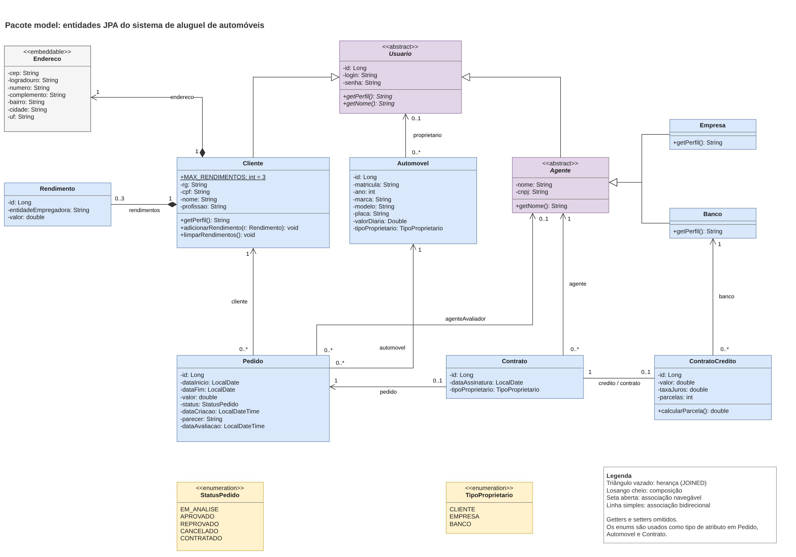</a>

**2.2 Controllers → Services → Repositories (e segurança)**

Cada `RestController` delega para o seu `Service`, que usa os `Repository` (Spring Data JPA). As cores das setas identificam o service de origem. Embaixo, as classes de segurança: `TokenService`, `SecurityConfig` e `UsuarioLogado`.

<a href="docs/imagens/uml/backend-controllers-services-repositories.png">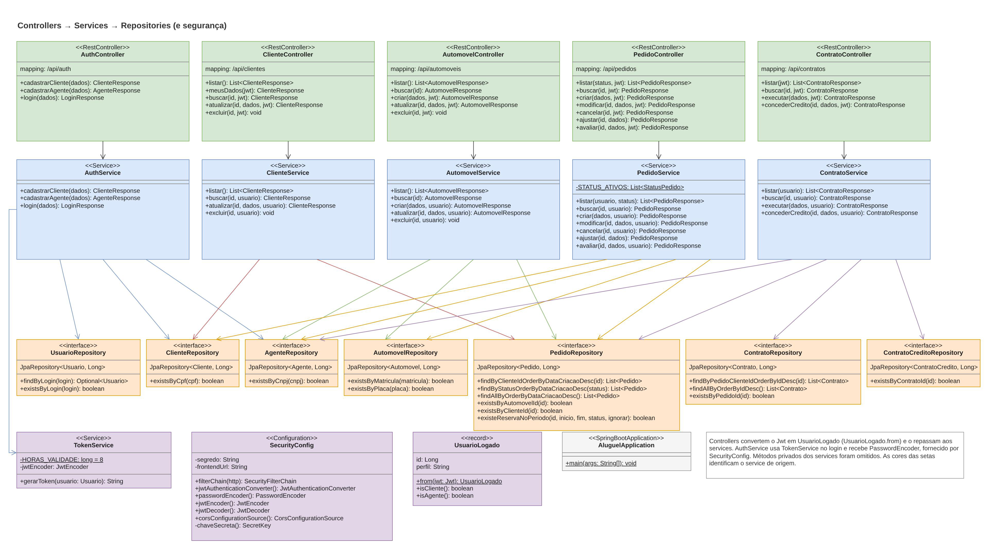</a>

**2.3 Pacotes `dto` e `exception`**

DTOs de entrada (Requests) e saída (Responses), todos `record`, e o tratamento global de erros com `GlobalExceptionHandler` e `ErroResponse`.

<a href="docs/imagens/uml/backend-dto-exception.png">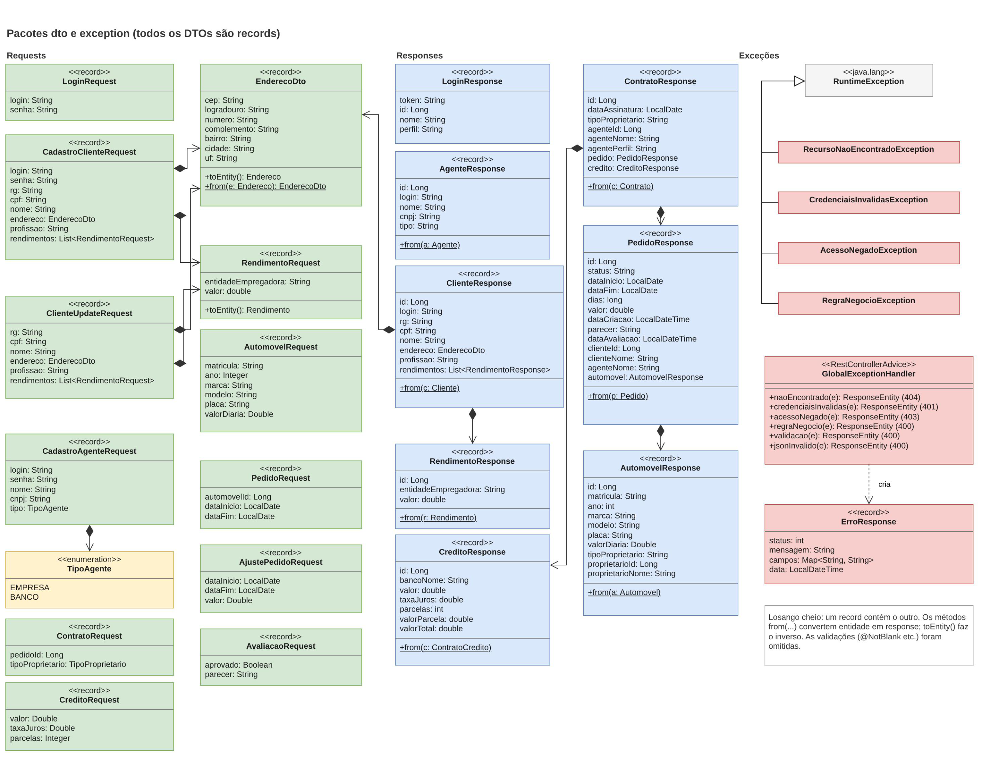</a>

#### 3. Versão inicial (v1 — modelagem antes do código)

| Diagrama de Casos de Uso (v1) | Diagrama de Classes (v1) |
| :---: | :---: |
| <a href="docs/imagens/uml/casos-de-uso-v1.png">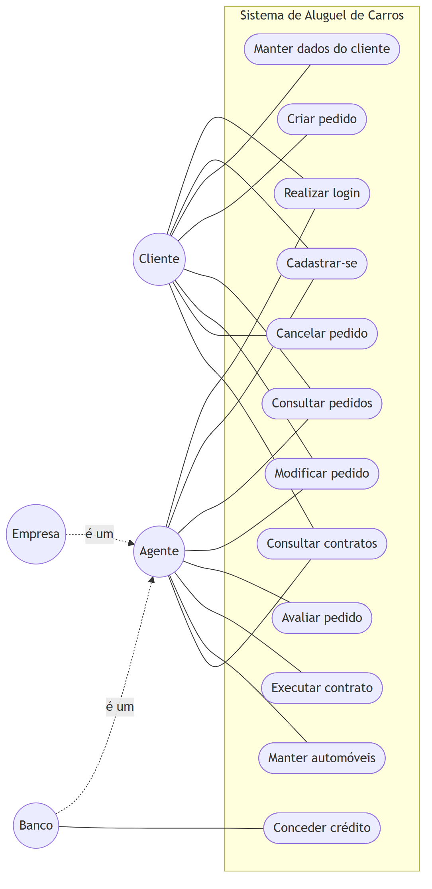</a> | <a href="docs/imagens/uml/classes-v1.png"></a> |
| **Diagrama de Pacotes (v1)** | |
| <a href="docs/imagens/uml/pacotes-v1.png"></a> | |

#### 4. Documentação dos diagramas

A documentação completa de cada diagrama (com o código Mermaid e as histórias de usuário) está em [`docs/`](docs/):

| Artefato | Versão inicial (v1) | Versão revisada (v2) |
| :--- | :---: | :---: |
| Histórias de Usuário | [v1](docs/historias-usuario/historias-usuario-v1.md) | [v2](docs/historias-usuario/historias-usuario-v2.md) |
| Diagrama de Casos de Uso | [v1](docs/diagramas/v1/casos-de-uso-v1.md) | [v2](docs/diagramas/v2/casos-de-uso-v2.md) |
| Diagrama de Classes | [v1](docs/diagramas/v1/classes-v1.md) | [v2](docs/diagramas/v2/classes-v2.md) |
| Diagrama de Pacotes | [v1](docs/diagramas/v1/pacotes-v1.md) | [v2](docs/diagramas/v2/pacotes-v2.md) |

**Principais mudanças da v1 (antes do código) para a v2 (como o sistema ficou):**

| Ponto | v1 (inicial) | v2 (final) |
|---|---|---|
| Endereço do cliente | Um texto só | Classe `Endereco` com CEP, rua, número, bairro, cidade e UF, preenchida pelo CEP |
| Valor do pedido | Não dizia como calcular | Dias × `valorDiaria` do automóvel. O agente pode negociar outro valor |
| Proprietário do carro | Só o `tipoProprietario` | Associação `proprietario` com o usuário dono. Muda ao executar o contrato |
| Avaliação | Só `parecer` | Parecer obrigatório, mais `agenteAvaliador` e `dataAvaliacao` |
| Operações | Métodos nas entidades (`criarPedido`, `avaliarPedido`...) | Ficaram nas classes `service` (padrão MVC do Spring) |
| Crédito | Valor, juros e parcelas | Mais o cálculo da parcela (Price) e limites de valor, juros e parcelas |
| Casos de uso | 12 | 15: o ajuste pelo agente foi separado, e entraram consultar clientes e consultar automóveis |
| Pacotes | MVC básico | Mais `exception` no back-end e `context`/`utils` no front-end |

---

## 🔧 Instalação e Execução

### Pré-requisitos
Certifique-se de que o usuário tenha o ambiente configurado.

* **Java JDK:** Versão **25** (Necessário para o **Back-end Spring Boot**)
* **Apache Maven:** Versão **3.9** ou superior
* **Node.js:** Versão **20.19** ou superior (Necessário para o **Front-end React + Vite**)
* **Gerenciador de Pacotes:** npm
* **Banco de Dados:** um projeto no [Supabase](https://supabase.com/) **ou** o **Docker** (para rodar o PostgreSQL localmente)

---

### 🔑 Variáveis de Ambiente

Crie arquivos `.env` específicos e/ou configure as variáveis de ambiente no seu sistema para cada parte da aplicação. Cada pasta tem um `.env.example` para copiar. Os arquivos `.env` estão no `.gitignore` e **nunca devem ser enviados ao GitHub**.

#### 1 Back-end (Spring Boot)

Crie o arquivo **`backend/.env`** a partir de [`backend/.env.example`](backend/.env.example). O Spring lê esse arquivo automaticamente (`spring.config.import=optional:file:.env[.properties]`), desde que o back-end seja executado **de dentro da pasta `backend`**. As mesmas variáveis podem ser definidas como variáveis de ambiente do sistema.

| Variável | Descrição | Exemplo |
| :--- | :--- | :--- |
| `PORT` | Porta onde o Back-end será executado (opcional, padrão `8080`). | `8080` |
| `DB_URL` | URL de conexão JDBC (PostgreSQL / Supabase Session pooler). | `jdbc:postgresql://aws-1-sa-east-1.pooler.supabase.com:5432/postgres?sslmode=require` |
| `DB_USERNAME` | Usuário do banco de dados. | `postgres.abcdefghijklmnop` |
| `DB_PASSWORD` | Senha do banco de dados. | `senha-segura-123` |
| `JWT_SECRET` | Chave secreta para assinatura dos tokens (mínimo 32 caracteres). | `um-texto-aleatorio-com-pelo-menos-32-caracteres` |
| `FRONTEND_URL` | Origem(ns) liberada(s) no CORS, separadas por vírgula; aceita `*` (opcional, padrão `http://localhost:5173`). | `https://lab2-diw.vercel.app,https://lab2-diw-*.vercel.app` |

#### 2 Front-end (React, Vite)

Crie um arquivo **`.env`** na raiz da pasta `/frontend` a partir de [`frontend/.env.example`](frontend/.env.example). O prefixo `VITE_` expõe a variável ao *bundle* da aplicação.

| Variável | Descrição | Exemplo |
| :--- | :--- | :--- |
| `VITE_API_URL` | URL base do endpoint do Back-end Spring Boot. | `http://localhost:8080/api` |

---

#### 3 Variáveis de Ambiente na Vercel e no Render

A Vercel e o Render permitem configurar variáveis no painel de cada projeto.

---

##### **Vercel – Front-end com Vite usando a API do Render**

*Project Settings > Environment Variables*

```
VITE_API_URL=https://lab2diw.onrender.com/api
```

> **Obs:** As variáveis de ambiente em projetos **Vite** precisam começar com `VITE_` para que o Vite as reconheça e as inclua no *bundle* do frontend. Elas são lidas **na hora do build**: depois de alterar, é preciso fazer **Redeploy**.

---

##### **Render – Back-end Spring Boot (Docker) com PostgreSQL no Supabase**

*Service > Environment*

```
DB_URL=jdbc:postgresql://aws-1-sa-east-1.pooler.supabase.com:5432/postgres?sslmode=require
DB_USERNAME=postgres.<id-do-projeto>
DB_PASSWORD=<senha-do-banco>
JWT_SECRET=<texto-aleatorio-com-32-ou-mais-caracteres>
FRONTEND_URL=https://lab2-diw.vercel.app,https://lab2-diw-*.vercel.app
```

> [!IMPORTANT]
> O `FRONTEND_URL` deve ser a origem exata do site, **sem `/` no final**. Caso contrário, o navegador bloqueia as requisições por CORS.

---

Para adicionar essas variáveis:

1.  **Vercel:** acesse `https://vercel.com/<seu-usuario>/<seu-projeto>/settings/environment-variables` e clique em **"Add"**.
2.  **Render:** abra o serviço, vá em **Environment** e clique em **"Add Environment Variable"** (ou **"Add from .env"** para colar o arquivo inteiro).

Alternativamente, se estiver desenvolvendo localmente, crie um arquivo **`.env`** dentro da pasta **`frontend`** com o seguinte conteúdo:

```
# Variável essencial para conectar ao Back-end Spring Boot rodando localmente (porta 8080)
VITE_API_URL=http://localhost:8080/api
```

> 💡 **Localização:** Garanta que este arquivo esteja em **`/frontend/.env`** para que o **Vite** consiga carregá-lo durante o desenvolvimento.

### 📦 Instalação de Dependências

Clone o repositório e instale as dependências.

1.  **Clone o Repositório:**

```bash
git clone https://github.com/Gentil-sudo/lab2Diw.git
cd lab2Diw
```

2.  **Instale as Dependências (Monorepo):**

Como o projeto está dividido, você precisa instalar as dependências separadamente para o Front-end (React, usando npm) e garantir que o Back-end (Spring Boot, usando Maven) tenha suas dependências resolvidas.

#### Front-end (React)

Acesse a pasta do Front-end e instale as dependências do Node.js:

```bash
cd frontend
npm install
cd .. # Retorna para a raiz
```

#### Back-end (Spring Boot)

O projeto usa **Maven** (`pom.xml`). Execute o build limpo antes de rodar:

```bash
cd backend
mvn clean install
cd ..
```

---

### 💾 Inicialização do Banco de Dados (PostgreSQL)

O projeto utiliza **PostgreSQL**. Há duas formas de ter o banco:

1. **Supabase (usado em produção):**
   1. Crie um projeto no [Supabase](https://supabase.com/dashboard).
   2. Clique no botão **Connect** (topo do painel) e escolha **Session pooler**. Copie o host e o usuário (`postgres.<id-do-projeto>`).
   3. A senha é a do banco, definida ao criar o projeto. Se esqueceu, gere outra em **Database > Settings > Reset database password**.
   4. Monte o `DB_URL` com o prefixo `jdbc:` (o Supabase mostra só `postgresql://...`).

2. **Docker (ambiente local):**  
   (Certifique-se que o Docker está em execução)

```bash
docker run --name aluguel-db -e POSTGRES_USER=postgres -e POSTGRES_PASSWORD=postgres -e POSTGRES_DB=aluguel -p 5432:5432 -d postgres:16
```

   Nesse caso, use no `backend/.env`: `DB_URL=jdbc:postgresql://localhost:5432/aluguel`, `DB_USERNAME=postgres` e `DB_PASSWORD=postgres`.

3. **Migrações:**
   O Back-end **Spring Boot** gerencia o schema automaticamente no startup via Hibernate (`spring.jpa.hibernate.ddl-auto=update`). **Nenhuma ação manual é necessária**, basta rodar o Back-end (veja a próxima seção).

---

### ⚡ Como Executar a Aplicação
Execute a aplicação em modo de desenvolvimento em **dois terminais separados**.

#### Terminal 1: Back-end (Spring Boot)

Inicie a API do Spring Boot. Ela vai se conectar ao banco configurado no `backend/.env`.

```bash
cd backend
mvn spring-boot:run
```
🚀 *O Back-end estará disponível em **http://localhost:8080/api**.*

---

#### Terminal 2: Front-end (React, Vite)

Inicie o servidor de desenvolvimento do Front-end.

```bash
cd frontend
npm run dev
```
🎨 *O Front-end estará disponível em **http://localhost:5173**.*

---

#### 🐳 Execução Local Completa com Docker Compose (Incluindo Banco de Dados)

Para uma execução local que inclui o serviço de Back-end (**Spring Boot**), Front-end (**React** servido pelo Nginx) e o banco de dados **PostgreSQL**, usamos o **[`docker-compose.yml`](docker-compose.yml)** para orquestração. Não é preciso criar nenhum `.env`: as variáveis já estão no arquivo.

Antes de tudo, certifique-se de que o **Docker Desktop** (no Mac/Windows) ou o **serviço Docker** (em Linux) está em execução.

- **No Mac/Windows**: basta abrir o aplicativo **Docker Desktop**.
- **No Linux**: rode o comando abaixo para iniciar o serviço:

```bash
sudo systemctl start docker
```

---

#### 📦 Passos para build, inicialização e execução

1. Acesse a pasta raiz do projeto (onde o arquivo `docker-compose.yml` está localizado):

```bash
cd lab2Diw
```

2. Suba todos os serviços (Back-end, Front-end e Banco de Dados) definidos no `docker-compose.yml`:

```bash
docker compose up --build -d
```

> [!NOTE]
> 💡 O parâmetro `--build` garante que as imagens mais recentes do projeto sejam geradas, e `-d` executa em segundo plano.

3. Verifique se os containers estão rodando (`aluguel-db`, `aluguel-backend` e `aluguel-frontend`):

```bash
docker ps
```

4. **Migrações do Banco de Dados:**
   O Hibernate cria as tabelas na **inicialização do serviço** de back-end.

* **Verificação:** confira nos logs se a aplicação subiu (`Started AluguelApplication`):
    ```bash
    docker logs aluguel-backend
    ```

5. Abra no navegador: <http://localhost:5173>
   > O banco local começa vazio: crie as contas em **Cadastre-se** (os botões de acesso rápido usam as contas do ambiente de produção).

6. Para parar e remover todos os containers e redes (o volume `dados-postgres` com os dados é mantido):

```bash
docker compose down
```

✅ **Em resumo:** Usar **`docker compose`** simplifica a execução do ambiente completo, isolando as dependências de **Java (Spring Boot)** e **Node.js (React)** e garantindo que o PostgreSQL esteja disponível.

---

## 🚀 Deploy
A aplicação está publicada em três serviços:

| Parte | Serviço | Endereço |
| :--- | :--- | :--- |
| Front-end | Vercel | https://lab2-diw.vercel.app |
| Back-end | Render (Docker) | https://lab2diw.onrender.com/api |
| Banco de dados | Supabase (PostgreSQL) | região `sa-east-1` (São Paulo) |

1.  **Build do Projeto:**
    O build de cada parte é feito pelo próprio provedor a cada `push`, mas pode ser executado manualmente (JAR para o Back-end e arquivos estáticos para o Front-end):

```bash
# 1. Build do Front-end (React/Vite) - Gera a pasta /dist com arquivos estáticos
cd frontend
npm run build

# 2. Build do Back-end (Spring Boot/Maven) - Gera o arquivo .jar executável em /target
cd ../backend
mvn clean package
```

2.  **Configuração do Ambiente de Produção:**
    * **Render (Back-end):** *New > Web Service*, repositório `Gentil-sudo/lab2Diw`, **Root Directory** `backend`, **Language** `Docker`, **Instance Type** `Free`. O Render usa o [`backend/Dockerfile`](backend/Dockerfile) e informa a porta pela variável `PORT`.
    * **Vercel (Front-end):** *Add New > Project*, mesmo repositório, **Root Directory** `frontend` (Vite é detectado sozinho). O [`frontend/vercel.json`](frontend/vercel.json) redireciona todas as rotas para o `index.html`, para o React Router funcionar ao recarregar a página.

> 🔑 **Variáveis Cruciais:** configure as variáveis de **conexão com o banco de dados** (`DB_URL`, `DB_USERNAME`, `DB_PASSWORD`), o `JWT_SECRET` e o `FRONTEND_URL` no Render, e a **URL da API de produção** (`VITE_API_URL`) na Vercel. Veja [Variáveis de Ambiente na Vercel e no Render](#3-variáveis-de-ambiente-na-vercel-e-no-render).

3.  **Execução em Produção:**
    A forma de execução depende do provedor, mas equivale a:

```bash
# ☕ Execução do Back-end Spring Boot (Java JAR)
# Este comando inicia a API usando o artefato JAR gerado.
java -jar backend/target/aluguel-0.0.1-SNAPSHOT.jar

# 🟢 Execução do Front-end (React/Vite)
# O Front-end (arquivos estáticos) não é executado via Node, mas servido por um servidor web
# (Vercel em produção, Nginx no docker-compose). Para simular localmente:
npm install -g serve
serve -s frontend/dist
```

---

## 📂 Estrutura de Pastas

```
.
├── .gitignore                    # 🧹 Ignora arquivos/pastas não versionadas (.env, node_modules, target, etc.).
├── README.md                     # 📘 Documentação principal do projeto.
├── CONTRIBUTING.md               # 🤝 Guia de contribuição.
├── docker-compose.yml            # 🐳 Orquestração dos containers (banco, back-end e front-end).
│
├── /frontend                     # 📁 Aplicação React + Vite
│   ├── .env.example              # 🧩 Variáveis de ambiente do Front-end.
│   ├── Dockerfile                # 🐳 Docker build do Front-end (Vite + Nginx).
│   ├── nginx.conf                # 🌐 Configuração do Nginx para a SPA.
│   ├── vercel.json               # ☁️ Rewrite das rotas para a SPA na Vercel.
│   ├── index.html                # 📄 Página base (aplica o tema antes do React carregar).
│   ├── /public                   # 📂 Arquivos estáticos (logo, emblema e favicon).
│   ├── /src                      # 📂 Código-fonte React
│   │   ├── /components           # 🧱 Componentes reutilizáveis (UI).
│   │   ├── /pages                # 📄 Páginas/rotas da aplicação (inclui DesignSystem.jsx).
│   │   ├── /services             # 🔌 Chamadas HTTP à API.
│   │   ├── /context              # 🔐 Usuário logado e tema claro/escuro (Context API).
│   │   ├── /utils                # 🛠️ Máscaras e formatação.
│   │   └── index.css             # 🎨 Estilos globais e tokens de design dos dois temas.
│   ├── package.json              # 📦 Dependências e scripts.
│   └── package-lock.json         # 🔒 Lockfile das dependências.
│
├── /backend                      # 📁 Aplicação Spring Boot
│   ├── .env.example              # 🧩 Variáveis de ambiente do Back-end.
│   ├── Dockerfile                # 🐳 Docker build do Back-end (usado no Render).
│   ├── requests.http             # 🔌 Requisições de exemplo (REST Client).
│   │
│   ├── /src/main/java            # 📂 Código-fonte Java
│   │   └── /br/pucminas/aluguel
│   │       ├── /controller       # 🎮 Endpoints REST.
│   │       ├── /service          # ⚙️ Regras e lógica de negócio.
│   │       ├── /repository       # 🗄️ Repositórios (Spring Data JPA).
│   │       ├── /model            # 🧬 Entidades persistentes (JPA).
│   │       ├── /dto              # ✉️ Data Transfer Objects.
│   │       ├── /exception        # 💥 Exceptions e handler global.
│   │       └── /security         # 🛡️ JWT, BCrypt, CORS e permissões (Spring Security).
│   │
│   ├── /src/main/resources       # 📂 Recursos do Spring Boot
│   │   └── application.properties # ⚙️ Configuração principal da aplicação.
│   │
│   ├── /src/test/java            # 🧪 Testes de unidade (JUnit + Mockito).
│   └── pom.xml                   # 🛠️ Build e dependências (Maven).
│
└── /docs                         # 📚 Documentação
    ├── /historias-usuario        # 📝 Histórias de usuário (v1, v2).
    ├── /diagramas                # 📐 Diagramas UML com o código Mermaid (v1, v2) e uml-backend.pdf.
    ├── /imagens                  # 🖼️ Capturas de tela.
    │   └── /uml                  # 📐 Diagramas UML em PNG.
    └── design-system.md          # 🎨 Origem do design system (a versão visual está na rota /design-system).
```

---

## 🎥 Demonstração

Prints das principais telas da aplicação.

> [!WARNING]
> As imagens estão versionadas na pasta [`docs/imagens/`](docs/imagens/) do próprio repositório.

### 📱 Aplicativo Mobile

- **Não se aplica:** o projeto não tem aplicativo nativo. O site é responsivo e pode ser usado pelo navegador do celular em [lab2-diw.vercel.app](https://lab2-diw.vercel.app).

### 🌐 Aplicação Web

Para melhor visualização, as telas principais estão organizadas lado a lado.

| Tela | Captura de Tela |
| :---: | :---: |
| **Login (modo claro)** | **Login (modo escuro)** |
| 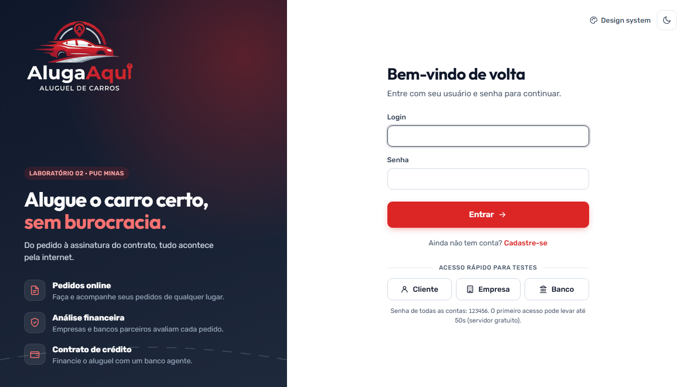 | 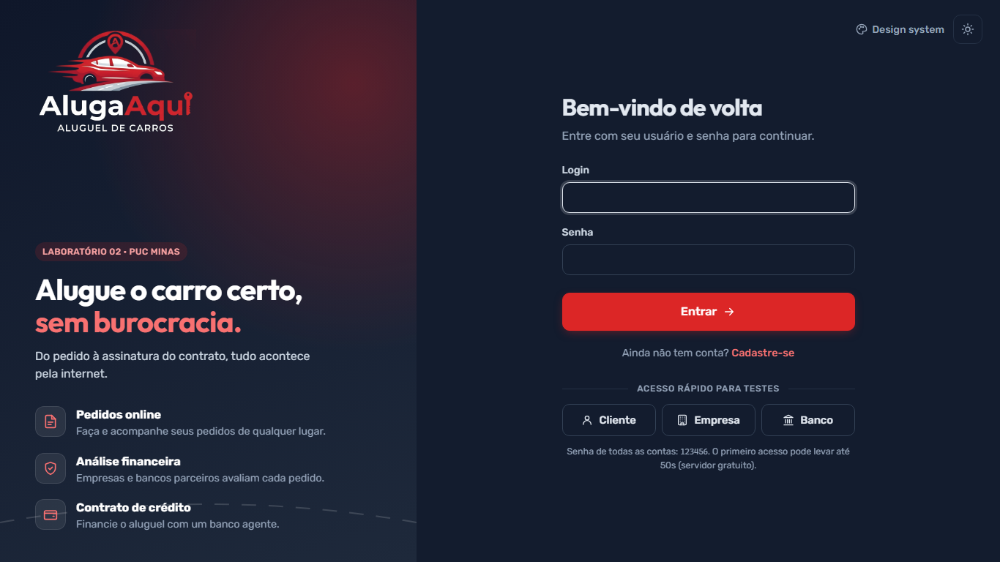 |
| **Início do Cliente** | **Meus Pedidos** |
| 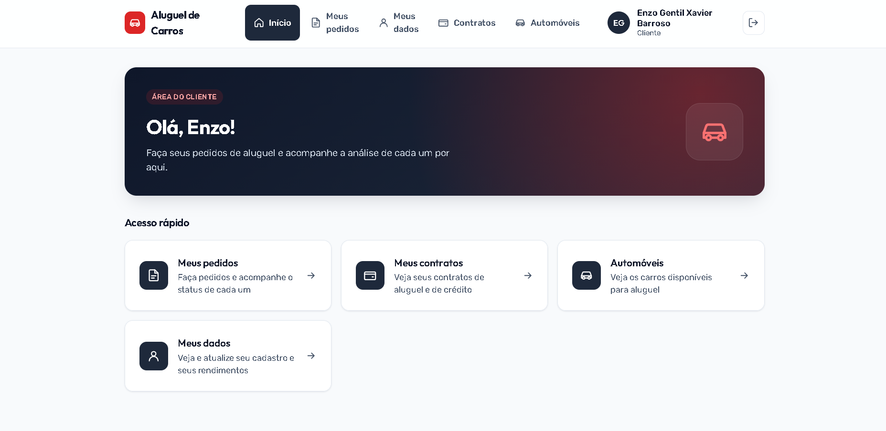 | 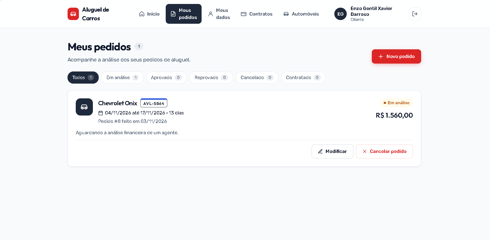 |
| **Novo Pedido de Aluguel** | **Automóveis** |
| 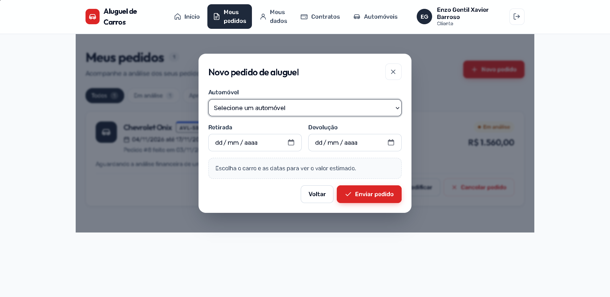 | 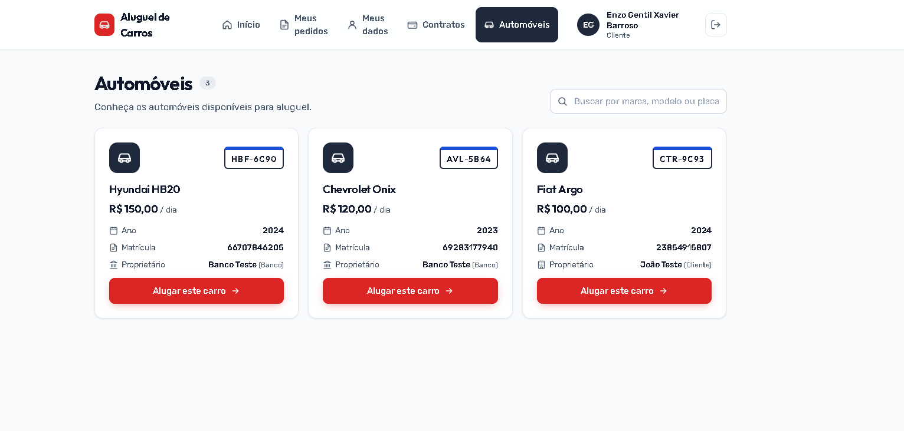 |
| **Meus Contratos** | **Meus Dados** |
| 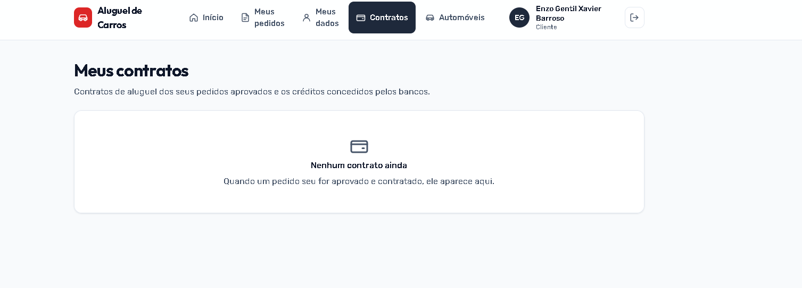 | 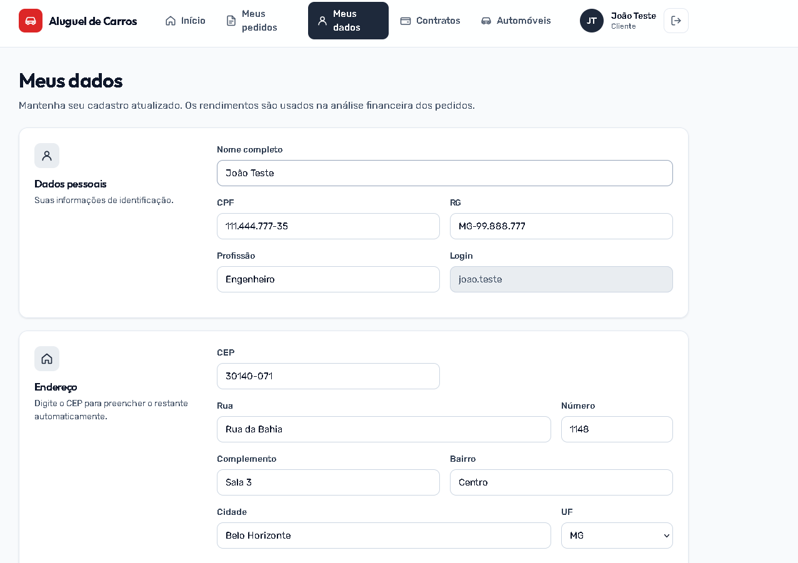 |
| **Design System** | **Telas por Perfil** |
| 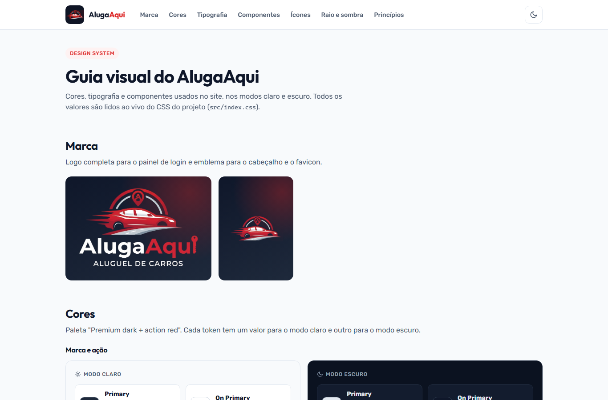 | **Cliente:** Início, Meus pedidos, Contratos, Automóveis, Meus dados<br>**Empresa:** Início, Análise de pedidos, Contratos, Automóveis, Clientes<br>**Banco:** tudo da Empresa + conceder crédito |

### 💻 Exemplo de Saída no Terminal (para Back-end, API, CLI)

#### 1. Demonstração da API (Exemplo com cURL)

Login com uma das contas de teste e, em seguida, listagem de automóveis com o token recebido:

```bash
# Faz o login e recebe o token JWT
curl -X POST 'https://lab2diw.onrender.com/api/auth/login' \
     -H 'Content-Type: application/json' \
     -d '{"login": "teste.banco", "senha": "123456"}'

# Chama o endpoint de listagem de automóveis com o token de autenticação
curl -X GET 'https://lab2diw.onrender.com/api/automoveis' \
     -H 'Authorization: Bearer <seu-jwt-token>'
```

**Saída Esperada (login com senha errada):**
```json
{
  "status": 401,
  "mensagem": "Login ou senha inválidos",
  "campos": null,
  "data": "2026-11-04T20:53:17.658445741"
}
```

**Endpoints principais:**

| Método | Rota | Quem usa |
|---|---|---|
| POST | `/api/auth/cadastro/cliente`, `/api/auth/cadastro/agente`, `/api/auth/login` | Todos (sem login) |
| GET / PUT / DELETE | `/api/clientes/me`, `/api/clientes/{id}` | Cliente |
| GET | `/api/clientes` | Agentes |
| GET / POST / PUT / DELETE | `/api/automoveis` | Todos veem, agentes alteram |
| GET / POST / PUT | `/api/pedidos` | Cliente cria e modifica |
| PATCH | `/api/pedidos/{id}/cancelar` | Cliente |
| PATCH | `/api/pedidos/{id}/ajustar`, `/api/pedidos/{id}/avaliar` | Agentes |
| GET / POST | `/api/contratos` | Agentes executam, todos consultam |
| POST | `/api/contratos/{id}/credito` | Banco |

> Mais exemplos (cadastro, pedidos, avaliação, contratos e crédito) em [`backend/requests.http`](backend/requests.http).

---

#### 2. Demonstração de Execução de CLI/Script

Execução dos testes de unidade do back-end com o Maven:

```bash
cd backend
mvn test
```

**Saída Esperada:**
```text
[INFO] Tests run: 3, Failures: 0, Errors: 0, Skipped: 0 -- in br.pucminas.aluguel.model.ClienteTest
[INFO] Tests run: 3, Failures: 0, Errors: 0, Skipped: 0 -- in br.pucminas.aluguel.model.ContratoCreditoTest
[INFO] Tests run: 6, Failures: 0, Errors: 0, Skipped: 0 -- in br.pucminas.aluguel.service.ContratoServiceTest
[INFO] Tests run: 7, Failures: 0, Errors: 0, Skipped: 0 -- in br.pucminas.aluguel.service.PedidoServiceTest
[INFO] Tests run: 19, Failures: 0, Errors: 0, Skipped: 0
[INFO] BUILD SUCCESS
```

---

## 🧪 Testes

### Testes Unitários e de Integração
Os testes de unidade não precisam do banco de dados: eles usam **Mockito** no lugar dos repositórios. Para rodar:

```
cd backend
mvn test
```
*Ferramentas utilizadas: JUnit 5 e Mockito.*

| Classe de teste | O que verifica |
|---|---|
| `ClienteTest` | Limite de 3 rendimentos |
| `ContratoCreditoTest` | Cálculo da parcela (com e sem juros) |
| `PedidoServiceTest` | Cálculo do valor, datas inválidas, carro já reservado, cancelamento e avaliação |
| `ContratoServiceTest` | Execução do contrato, troca do proprietário do carro e regras do crédito |

### Testes End-to-End (E2E)
O projeto ainda **não possui testes E2E automatizados**. A validação de ponta a ponta é feita manualmente seguindo o roteiro:

1. Entre como **Empresa** (acesso rápido) e cadastre um automóvel com o valor da diária.
2. Entre como **Cliente** e faça um pedido para esse carro.
3. Entre como agente, abra **Análise de pedidos**, ajuste se quiser e **aprove** com um parecer.
4. Ainda como agente, clique em **Executar contrato** e escolha quem fica dono do carro.
5. Entre como **Banco**, abra **Contratos** e clique em **Conceder crédito**.
6. Entre como **Cliente** e veja o contrato e as parcelas em **Contratos**.

*Ferramenta sugerida para automatizar: Playwright.*

---

## 🔗 Documentações utilizadas

* 📖 **Framework/Biblioteca (Front-end):** [Documentação Oficial do **React**](https://react.dev/reference/react)
* 📖 **Build Tool (Front-end):** [Guia de Configuração do **Vite**](https://vitejs.dev/config/)
* 📖 **Roteamento (Front-end):** [Documentação do **React Router**](https://reactrouter.com/)
* 📖 **Framework (Back-end):** [Documentação Oficial do **Spring Boot**](https://docs.spring.io/spring-boot/index.html)
* 📖 **Segurança (Back-end):** [Documentação do **Spring Security**](https://docs.spring.io/spring-security/reference/index.html)
* 📖 **Banco de Dados:** [Conectando ao **Supabase** (PostgreSQL)](https://supabase.com/docs/guides/database/connecting-to-postgres)
* 📖 **Containerização:** [Documentação de Referência do **Docker**](https://docs.docker.com/)
* 📖 **Deploy:** [**Render** com Docker](https://render.com/docs/docker) e [**Vercel**](https://vercel.com/docs)
* 📖 **Diagramas:** [**Mermaid**](https://mermaid.js.org/)
* 📖 **API externa:** [**ViaCEP**](https://viacep.com.br)
* 📖 **Guia de Estilo:** [**Conventional Commits** (Padrão de Mensagens)](https://www.conventionalcommits.org/en/v1.0.0/)
* 📖 **Documentação Interna:** [Design System do Projeto](https://lab2-diw.vercel.app/design-system) ([origem](./docs/design-system.md))

---

## 👥 Autores

| 👤 Nome | 🖼️ Foto | :octocat: GitHub | 💼 LinkedIn | 📤 Gmail |
|---------|----------|-----------------|-------------|-----------|
| Enzo Gentil | <div align="center"></div> | <div align="center"><a href="https://github.com/Gentil-sudo"></a></div> | <div align="center">—</div> | <div align="center"><a href="mailto:enzogentil.profissional@gmail.com"></a></div> |

---

## 🤝 Contribuição
Guia para contribuições ao projeto.

1.  Faça um `fork` do projeto.
2.  Crie uma branch para sua feature (`git checkout -b feature/minha-feature`).
3.  Commit suas mudanças (`git commit -m 'feat: Adiciona nova funcionalidade X'`). **(Utilize [Conventional Commits](https://www.conventionalcommits.org/en/v1.0.0/))**
4.  Faça o `push` para a branch (`git push origin feature/minha-feature`).
5.  Abra um **Pull Request (PR)**.

> [!IMPORTANT]
> 📝 **Regras:** Por favor, verifique o arquivo [`CONTRIBUTING.md`](./CONTRIBUTING.md) para detalhes sobre nosso guia de estilo de código e o processo de submissão de PRs.

---

## 🙏 Agradecimentos

Gostaria de agradecer aos seguintes canais e pessoas que foram fundamentais para o desenvolvimento deste projeto:

* [**Engenharia de Software PUC Minas**](https://www.instagram.com/engsoftwarepucminas/) - Pelo apoio institucional, estrutura acadêmica e fomento à inovação e boas práticas de engenharia.
* [**Prof. Dr. João Paulo Aramuni**](https://github.com/joaopauloaramuni) - Pelas aulas da disciplina, pelo material de **Spring Boot** e pelo template deste README.

---

## 📄 Licença

Este projeto foi desenvolvido para fins **acadêmicos** na disciplina DIAW da PUC Minas, sem fins comerciais.

---
