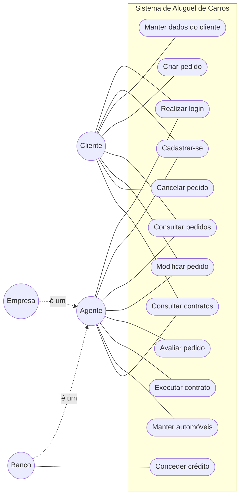

# Diagrama de Casos de Uso — v1

## Descrição dos casos de uso

| Caso de uso | Atores | Histórias |
|---|---|---|
| UC01 — Realizar login | Cliente, Agente | US03, US04 |
| UC02 — Cadastrar-se | Cliente, Agente | US01, US02 |
| UC03 — Manter dados do cliente | Cliente | US05, US06 |
| UC04 — Criar pedido | Cliente | US09 |
| UC05 — Consultar pedidos | Cliente, Agente | US10, US13 |
| UC06 — Modificar pedido | Cliente, Agente | US11, US14 |
| UC07 — Cancelar pedido | Cliente | US12 |
| UC08 — Avaliar pedido | Agente | US15 |
| UC09 — Executar contrato | Agente | US16 |
| UC10 — Conceder crédito | Banco | US17 |
| UC11 — Manter automóveis | Agente | US07, US08 |
| UC12 — Consultar contratos | Cliente, Agente | US18 |

> Todos os casos de uso (menos UC01 e UC02) exigem que o usuário esteja logado.
