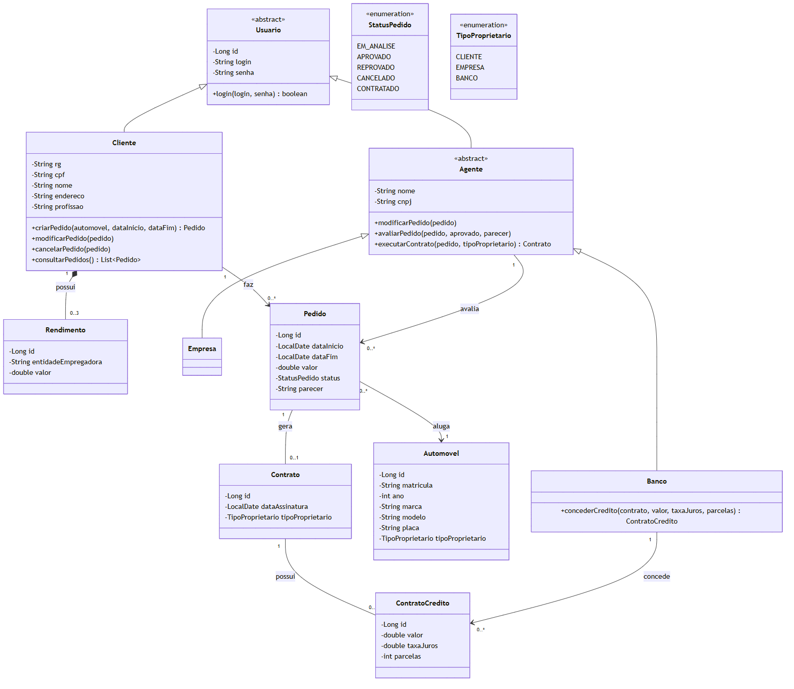
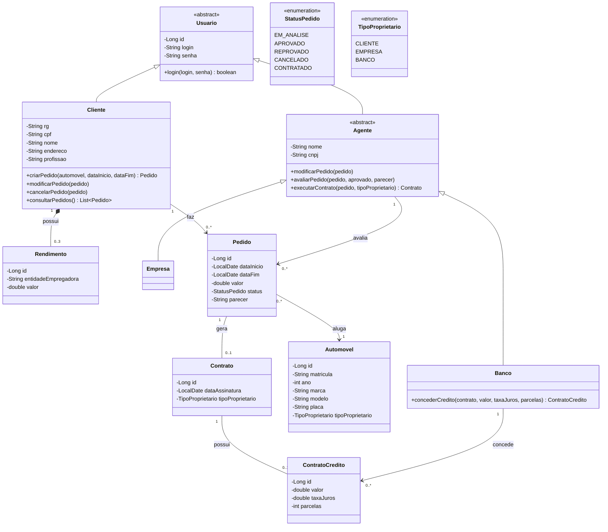

# Diagrama de Classes — v1

Código Mermaid do diagrama

## Observações

- Um cliente pode ter no máximo **3 rendimentos**.
- `Agente` é abstrato e se especializa em `Empresa` e `Banco`.
- Só o `Banco` pode conceder um `ContratoCredito`.
- O `tipoProprietario` do contrato define de quem o automóvel passa a ser propriedade.
