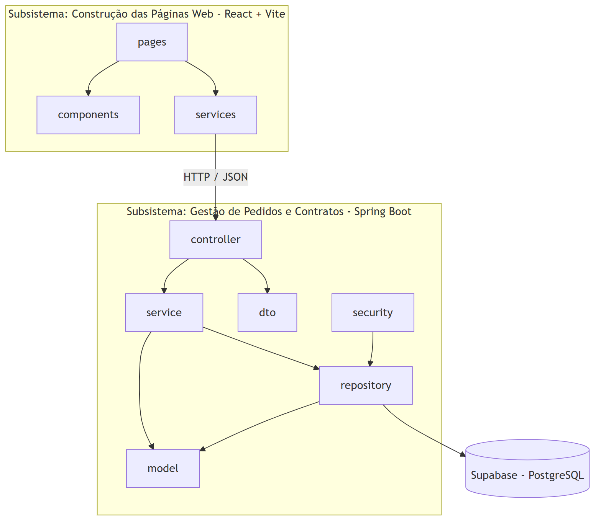
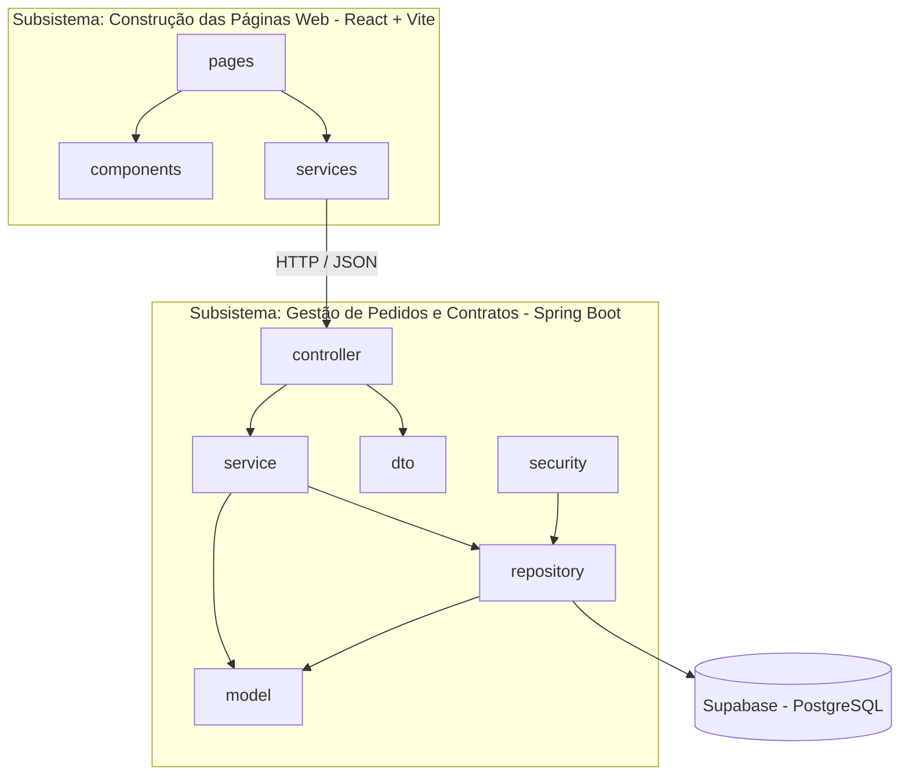

# Diagrama de Pacotes (Visão Lógica) — v1

O sistema é dividido em dois subsistemas, como pede o enunciado:

1. **Construção das páginas web** (front-end React + Vite)
2. **Gestão de pedidos e contratos** (back-end Spring Boot, arquitetura MVC)

Código Mermaid do diagrama

## Responsabilidade de cada pacote

| Pacote | Responsabilidade |
|---|---|
| `pages` | Telas do sistema (login, pedidos, clientes, etc.) |
| `components` | Componentes reutilizáveis (menu, formulários) |
| `services` (front) | Chamadas HTTP para a API |
| `controller` | Recebe as requisições HTTP (**C** do MVC) |
| `service` | Regras de negócio (ex.: só cancela pedido em análise) |
| `repository` | Acesso ao banco de dados (Spring Data JPA) |
| `model` | Entidades do sistema (**M** do MVC) |
| `dto` | Objetos de entrada e saída da API |
| `security` | Login e controle de acesso |

> A **View** (**V** do MVC) é o front-end React, que recebe os dados em JSON e monta as páginas.
