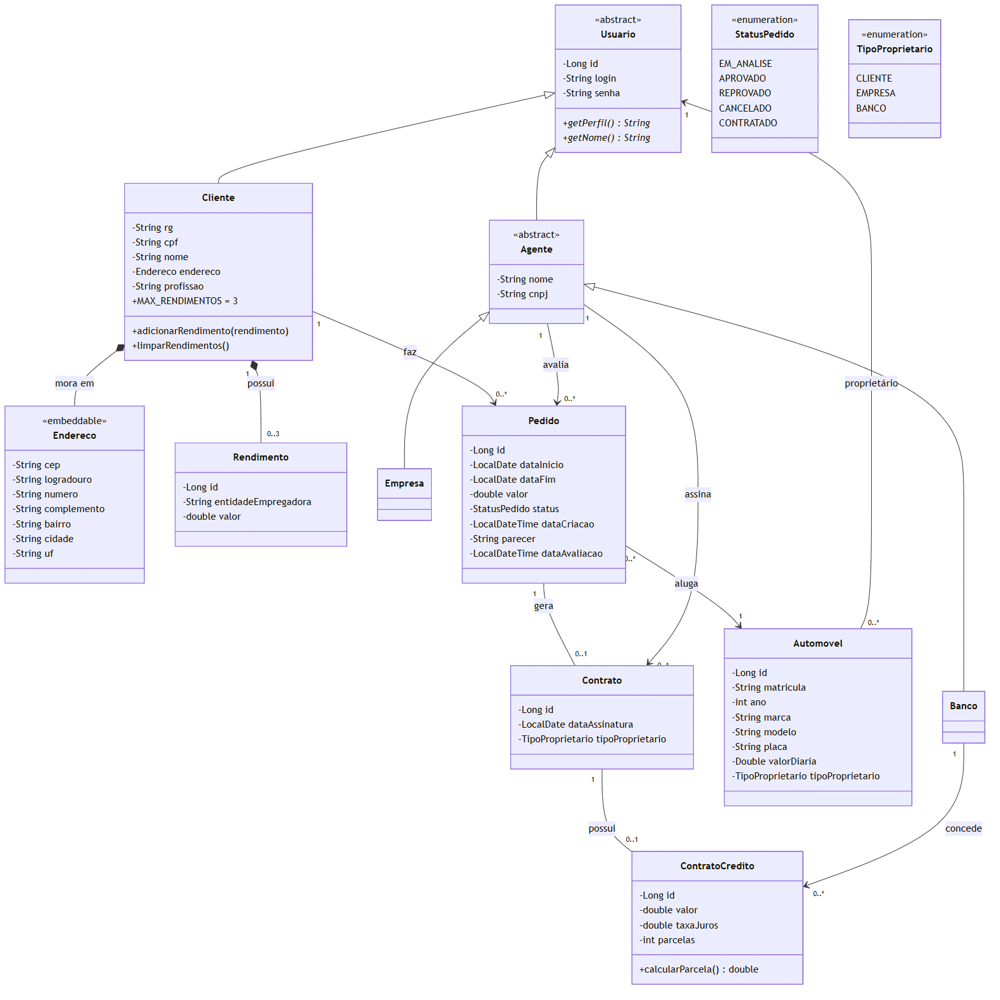
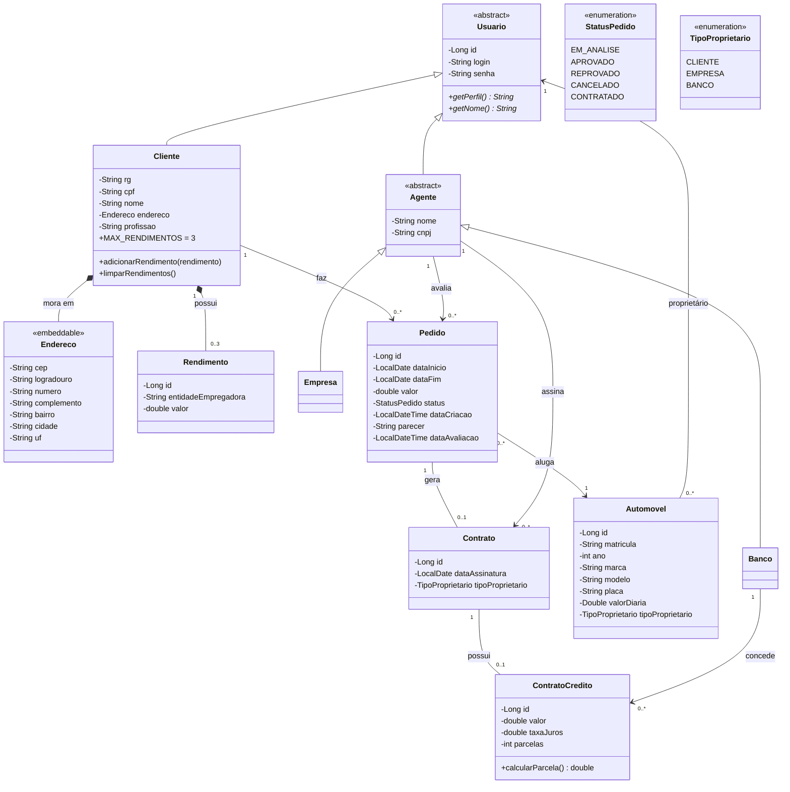
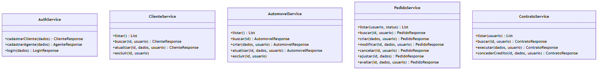
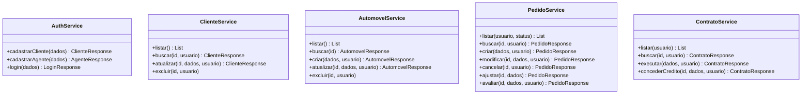

# Diagrama de Classes — v2

Versão revisada depois da implementação. Mostra as classes do pacote `model` como ficaram no código.

Código Mermaid do diagrama

## Classes de serviço (regras de negócio)

Na v1 as operações estavam nas entidades. Na v2 elas foram para a camada `service`, como manda o MVC com Spring.

Código Mermaid do diagrama

## O que mudou da v1 para a v2

| Classe | Mudança | Motivo |
|---|---|---|
| `Cliente` | `endereco` virou a classe `Endereco` (embutida na tabela) | Guardar CEP, rua, número, bairro, cidade e UF separados e preencher pelo CEP |
| `Cliente` | Ganhou `adicionarRendimento` e `limparRendimentos` | A regra de no máximo 3 rendimentos fica na própria entidade |
| `Automovel` | Ganhou `valorDiaria` | O valor do pedido é calculado como dias × diária |
| `Automovel` | Ganhou a associação `proprietario` (Usuario) | Registrar de quem é o carro: cliente, empresa ou banco |
| `Pedido` | Ganhou `dataCriacao`, `dataAvaliacao` e o `agenteAvaliador` | Saber quando o pedido foi feito, quando e por quem foi avaliado |
| `Contrato` | Ganhou a associação com o `Agente` que assinou | Saber quem executou o contrato |
| `ContratoCredito` | Ganhou `calcularParcela()` (tabela Price) | Mostrar a parcela e o total ao cliente |
| `Usuario`, `Cliente`, `Agente`, `Banco` | Os métodos `login`, `criarPedido`, `avaliarPedido`, `executarContrato` e `concederCredito` saíram das entidades | Foram para as classes `service` |
