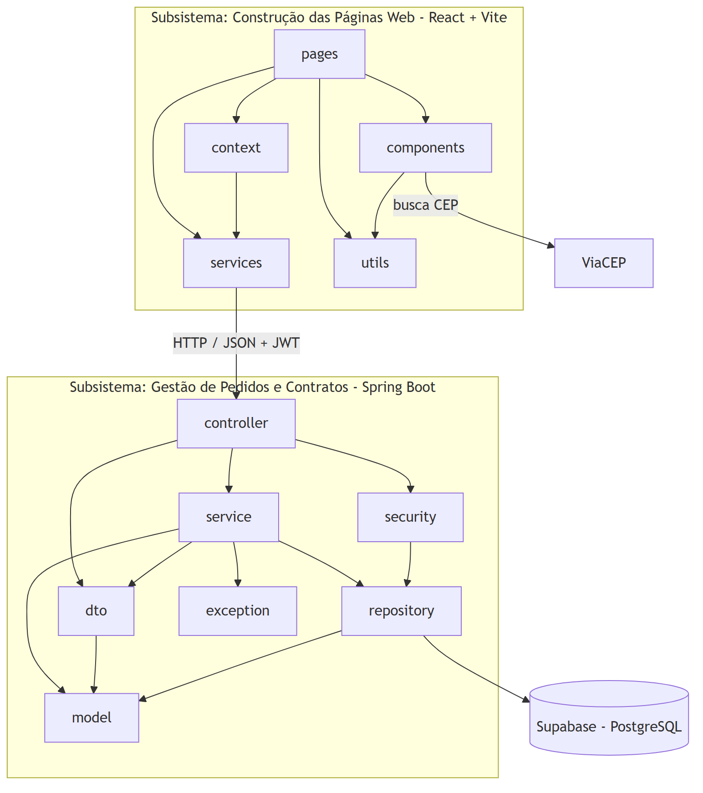
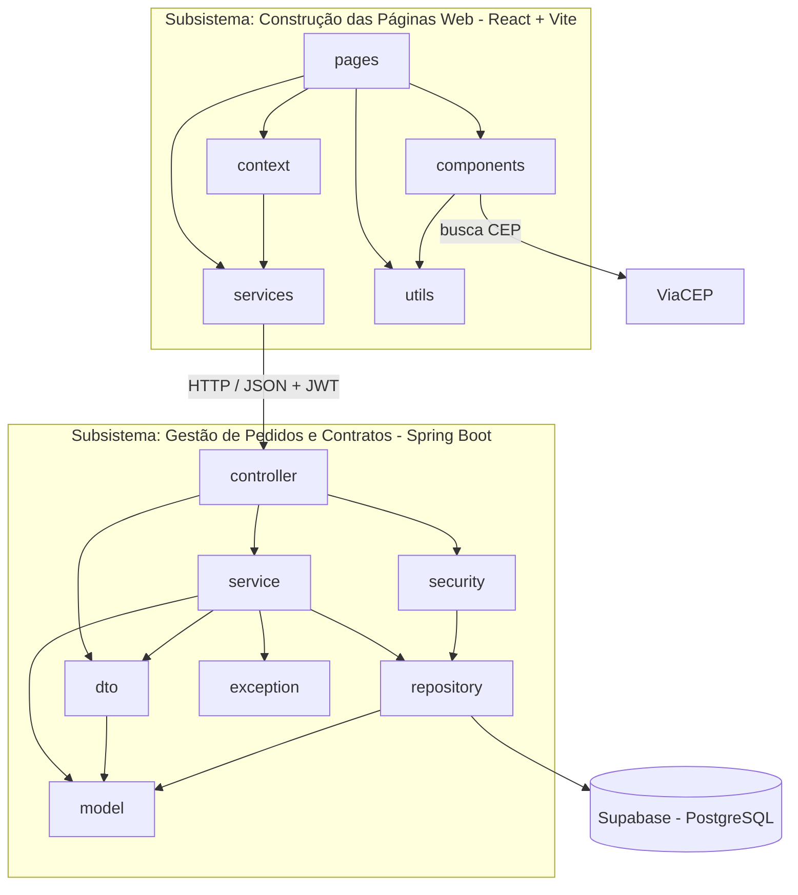

# Diagrama de Pacotes (Visão Lógica) — v2

Código Mermaid do diagrama

## Responsabilidade de cada pacote

| Pacote | Responsabilidade |
|---|---|
| `pages` | Telas: login, cadastro, início, meus dados, automóveis, pedidos, análise, contratos, clientes |
| `components` | Componentes reutilizáveis: menu, modal, campos, endereço, rendimentos, status |
| `context` | Guarda o usuário logado e o token (`AuthContext`) |
| `services` (front) | Chamadas HTTP para a API, mandando o token |
| `utils` | Máscaras de CPF, CNPJ, CEP, placa, dinheiro e porcentagem |
| `controller` | Recebe as requisições HTTP (**C** do MVC) |
| `service` | Regras de negócio |
| `repository` | Acesso ao banco de dados (Spring Data JPA) |
| `model` | Entidades do sistema (**M** do MVC) |
| `dto` | Objetos de entrada e saída da API, com as validações |
| `security` | Login com JWT, senha com BCrypt e permissões por perfil |
| `exception` | Erros de negócio e o tratamento padrão das respostas de erro |

## O que mudou da v1 para a v2

- No back-end entrou o pacote `exception`, para devolver os erros sempre no mesmo formato.
- No front-end entraram os pacotes `context` (sessão do usuário) e `utils` (máscaras dos campos).
- Entrou o serviço externo **ViaCEP**, que preenche o endereço a partir do CEP.
