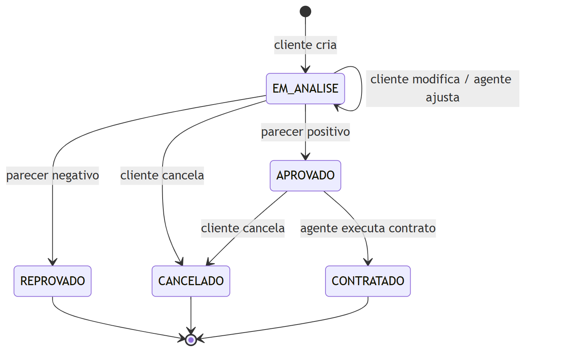
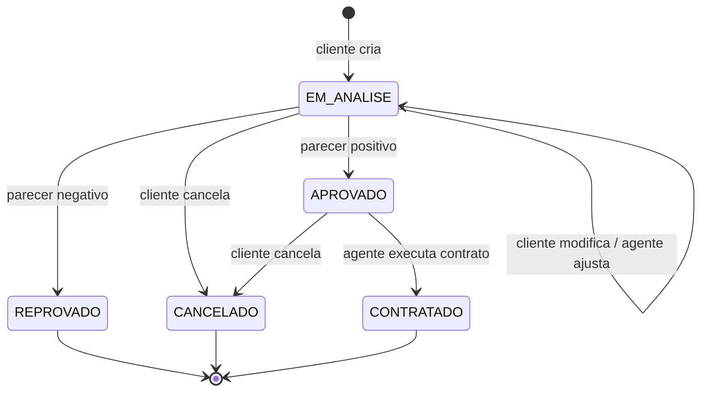

# Histórias de Usuário — v2

Versão revisada depois da implementação. As regras abaixo são as que o sistema realmente aplica. O que mudou desde a v1 está marcado com **(v2)**.

## Atores

- **Cliente**: usuário individual que faz pedidos de aluguel.
- **Agente**: empresa ou banco que avalia os pedidos e executa contratos.
- **Banco**: agente que também pode conceder contrato de crédito.

---

## Acesso ao sistema

**US01 — Cadastro de cliente**
Como visitante, quero me cadastrar como cliente, para poder usar o sistema.
- Informar RG, CPF, nome, endereço, profissão, login e senha.
- **(v2)** O endereço é separado em CEP, rua, número, complemento, bairro, cidade e UF. Ao digitar o CEP, o endereço é preenchido sozinho (ViaCEP).
- Posso informar até 3 rendimentos (empregador e valor).
- CPF e login não podem se repetir. **(v2)** O CPF precisa ser válido.
- **(v2)** A senha deve ter pelo menos 6 caracteres.

**US02 — Cadastro de agente**
Como empresa ou banco, quero me cadastrar como agente, para poder avaliar pedidos.
- Informar nome, CNPJ, tipo (empresa ou banco), login e senha.
- **(v2)** O CNPJ precisa ser válido e não pode se repetir.

**US03 — Login**
Como usuário cadastrado, quero entrar com meu login e senha, para acessar o sistema.
- Só as telas de login e cadastro podem ser acessadas sem estar logado.
- **(v2)** A sessão dura 8 horas (token JWT). Cada perfil só vê as telas que pode usar.

**US04 — Logout**
Como usuário, quero sair do sistema, para encerrar minha sessão.

---

## Cliente

**US05 — Ver e editar meus dados**
Como cliente, quero ver e alterar meus dados e rendimentos, para mantê-los atualizados.
- Não pode ter mais de 3 rendimentos.

**US06 — Excluir minha conta**
Como cliente, quero excluir meu cadastro, para deixar de usar o sistema.
- **(v2)** Não é possível excluir a conta se o cliente já tiver pedidos (para não perder o histórico).

---

## Automóveis

**US07 — Cadastrar automóvel**
Como agente, quero cadastrar automóveis (matrícula, ano, marca, modelo, placa e **valor da diária (v2)**), para que possam ser alugados.
- Matrícula e placa não podem se repetir.
- **(v2)** A placa aceita o modelo antigo (ABC-1234) e o Mercosul (ABC-1D23).
- **(v2)** O agente que cadastra fica como proprietário do carro.

**US08 — Listar, editar e remover automóveis**
Como agente, quero listar, editar e remover automóveis, para manter o cadastro correto.
- **(v2)** Só o proprietário pode editar ou remover. Um carro com pedidos não pode ser removido.

**US20 — Consultar automóveis (v2)**
Como cliente, quero ver os automóveis com o valor da diária, para escolher qual alugar.
- Pelo cartão do carro já abro o pedido de aluguel.

---

## Pedidos (cliente)

**US09 — Criar pedido**
Como cliente, quero criar um pedido escolhendo um automóvel e as datas, para solicitar um aluguel.
- O pedido começa com status **EM_ANALISE**.
- A data de fim deve ser depois da data de início.
- **(v2)** A data de início não pode estar no passado.
- **(v2)** O valor é calculado como dias × diária do carro.
- **(v2)** O carro não pode já estar reservado no período (pedidos em análise, aprovados ou contratados).

**US10 — Consultar meus pedidos**
Como cliente, quero ver meus pedidos e o status de cada um, para acompanhar a solicitação.
- **(v2)** Posso filtrar por status e ver o parecer do agente.

**US11 — Modificar pedido**
Como cliente, quero alterar meu pedido, para corrigir o automóvel ou as datas.
- Só pode modificar se estiver **EM_ANALISE**.

**US12 — Cancelar pedido**
Como cliente, quero cancelar meu pedido, para desistir do aluguel.
- Só pode cancelar se estiver **EM_ANALISE** ou **APROVADO**.

---

## Pedidos (agente)

**US13 — Listar pedidos**
Como agente, quero ver os pedidos feitos pelos clientes, para analisá-los.
- **(v2)** A tela já abre mostrando os pedidos em análise.

**US14 — Ajustar pedido**
Como agente, quero alterar as datas ou o valor de um pedido, para ajustá-lo antes da avaliação.
- **(v2)** Só pode ajustar se estiver **EM_ANALISE**. O período também não pode bater com outra reserva.

**US15 — Avaliar pedido**
Como agente, quero dar um parecer financeiro positivo ou negativo, para aprovar ou reprovar o pedido.
- Parecer positivo: status **APROVADO**. Parecer negativo: status **REPROVADO**.
- **(v2)** O parecer é obrigatório (até 500 caracteres). Ficam registrados o agente e a data da avaliação.
- **(v2)** A tela mostra a renda do cliente e quanto o pedido compromete dela.

**US19 — Consultar clientes (v2)**
Como agente, quero ver os clientes cadastrados e seus rendimentos, para apoiar a análise financeira.

---

## Contratos

**US16 — Executar contrato**
Como agente, quero gerar o contrato de um pedido aprovado, para formalizar o aluguel.
- O contrato informa se o automóvel fica como propriedade do cliente, da empresa ou do banco.
- **(v2)** O proprietário só pode ser o cliente ou o próprio agente que assina. O carro passa a ser desse proprietário.
- O pedido passa para **CONTRATADO** e não pode mais ser cancelado.

**US17 — Contrato de crédito**
Como banco, quero associar um contrato de crédito ao aluguel, para financiar o cliente.
- Informar valor, taxa de juros e número de parcelas.
- **(v2)** Só bancos concedem crédito, e cada contrato tem no máximo um.
- **(v2)** O valor não pode passar do valor do contrato. A taxa vai de 0% a 20% ao mês, e as parcelas de 1 a 72.
- **(v2)** A parcela é calculada pela tabela Price e aparece antes de confirmar.

**US18 — Ver contratos**
Como usuário, quero ver os contratos ligados a mim, para acompanhar meus aluguéis.
- **(v2)** O cliente vê os contratos dos seus pedidos. O agente vê todos os contratos.

---

## Status do pedido

| Status | Quando acontece |
|---|---|
| EM_ANALISE | Cliente criou o pedido |
| APROVADO | Agente deu parecer positivo |
| REPROVADO | Agente deu parecer negativo |
| CANCELADO | Cliente cancelou |
| CONTRATADO | Agente executou o contrato |

Código Mermaid do diagrama

---

## Requisitos não funcionais

- RNF01: Sistema web.
- RNF02: Back-end em Java 25 com Spring Boot 4 e Maven, usando arquitetura MVC.
- RNF03: Front-end em React + Vite.
- RNF04: Banco de dados Supabase (PostgreSQL).
- RNF05: Login obrigatório com usuário e senha.
- **(v2)** RNF06: Senhas guardadas com BCrypt e acesso à API por token JWT.
- **(v2)** RNF07: Todo campo numérico tem máscara (CPF, CNPJ, CEP, placa, dinheiro, porcentagem).
- **(v2)** RNF08: Telas responsivas e acessíveis (rótulos nos campos, navegação por teclado).
